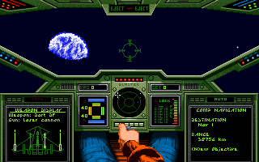
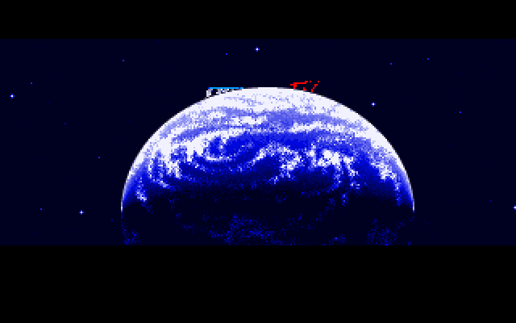
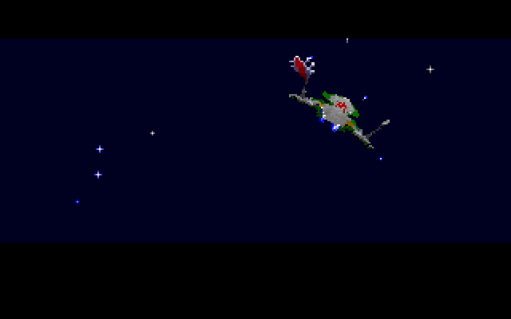
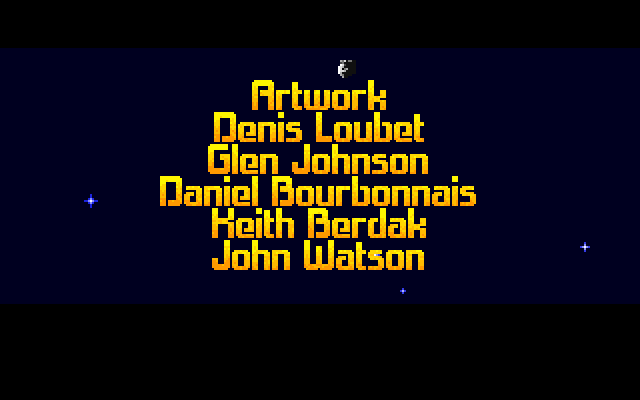

# Wing Commander — Static Recompilation

Static recompilation of **Wing Commander** (Origin Systems, 1990), the DOS
version on the *Wing Commander & Wing Commander II* CD, from its shipping
executable to C, built as a native Windows program. `WC.EXE` is a real-mode
Borland C++ program with 40 Borland VROOMM overlays, EMS, VGA mode 13h and
Origin's own compressed `.DRV` drivers, which it unpacks into its heap and
calls at run time; its 2,100-odd functions are lifted to C (the overlays made
resident first, the drivers captured on the first run and lifted on the next),
and `src/` is a small model of a 1990 PC (DOS, VGA, EMS, the timer, the
keyboard, an OPL2) for it to run on. No DOSBox, no emulator.

Built on the [pcrecomp](https://github.com/sp00nznet/pcrecomp) toolchain, on
its `main` branch, whose 16-bit
decoder and lifter do the work, no IDA. The runtime and lifter came from the
[Mario Is Missing DOS recomp](https://github.com/sp00nznet/marioismissing-dos).

## Getting Started

You need **your own copy**: the *Wing Commander & Wing Commander II* CD (or a
mounted image of it, or a copy of its `WC1` folder). Nothing from the game is
in this repository or downloaded for you; everything is built on your machine
from your copy.

### The setup scripts

1. Download this repository (the green **Code** button, then **Download ZIP**)
   and unzip it somewhere with 1 GB free.
2. Windows: put the disc in (or mount its image) and double-click
   **`Setup.cmd`**. Linux and macOS: not yet (`setup.sh` says so and stops).
3. Play with the **`Wing Commander`** shortcut in that folder.

The script checks for Python 3, CMake, Git and the Visual Studio 2022 C++
build tools, and asks before installing any of them with winget. It finds
`WC1\WC.EXE` on any drive or asks where it is (`Setup.cmd -GameDir E:\`
skips the question, `-Yes` answers yes to every install), copies the `WC1`
folder into `original\wc1`, clones pcrecomp
beside this folder (as `pcrecomp`), lifts `WC.EXE`, builds, runs the
self-test, then runs headless capture rounds (two, usually) until both of the
game's drivers are captured, lifting and building again after each, and leaves
the shortcut. A rerun skips finished steps (`-Force` redoes
the lift); if it stops, it says why in one sentence and the details are in
`setup.log`. Building by hand and the command line are in
**[docs/building.md](docs/building.md)**.

Esc skips the intro. The copy check asks a question from the *Claw Marks*
manual. "Start Vega Campaign" is clicked with the mouse.

## Status

**v0.1.0, early alpha: the first mission flies.** From the sign-in through the
bar, the barracks and the briefing to the Hornet's cockpit at Enyo, Nav 1,
with keyboard control.

| Area | State |
|---|---|
| Version recompiled | `WC1\WC.EXE` from *Wing Commander & Wing Commander II* (USA) CD, 304,976 bytes |
| Lift (`tools/lift.py wc1`) | 2,163 functions (40 overlays resident, 2 run-time drivers), 116,093 instructions, 0 unresolved; pcrecomp's own decoder, no IDA |
| Borland VROOMM overlays | ✅ 40 made resident (pcrecomp `tools/drm/vroomm.py`) |
| EMS | ✅ detected and filled ("Expanded Memory fully used") |
| The `.DRV` drivers it unpacks at run time | ✅ `TM.DRV` and `SUPERTM.DRV` captured at 36B4h and 3B93h on the first run and lifted on the next (pcrecomp `codeblob16`); 52 driver entries, no misses on the paths below |
| Title, intro, main menu | ✅ the concert-hall intro, the Earth flyby and the credits; the *Claw Marks* copy question (answer it); "Start Vega Campaign" |
| Pilot sign-in (the simulator screen) | ✅ name and callsign typed in; the simulator high scores |
| Bar, barracks, briefing, launch | ✅ hover labels and clicks; Halcyon's briefing plays through; the launch cut-scene |
| The first mission | ✅ flies: throttle, stop and turning answer the keys, asteroids and the planet move past. Not yet flown to the end; untouched it hits an asteroid and the funeral plays |
| Sound and music | ❌ not yet (no sound card configured) |
| Wing Commander II (`wingcommander2`) | lifts (124 overlays, 2,076 functions); not built or run yet |
| Headless mode | `--headless` with `--seconds`, `--keys`, `--shot-at`; `--record out.mp4` pipes to ffmpeg |
| Self-test (`selftest.exe`, no game data) | ✅ passes: the VGA, x87 and Sound Blaster/AdLib models |
| Conformance harness against the game | not yet ([ROADMAP](ROADMAP.md)) |
| `Setup.cmd` | tested from a fresh clone against a copy of the CD's `WC1`: two capture rounds, the shortcut, and a headless run with no misses |
| Toolkit | pcrecomp `main` |
| Linux, macOS | not yet |

[docs/lifting.md](docs/lifting.md) is the log of each wall and its fix, and
[ROADMAP.md](ROADMAP.md) what comes next.

## Screenshots

Real output of the recompiled game:

| | |
|---|---|
|  |  |
| The intro | The Earth flyby |
|  |  |
| A Kilrathi fighter in the intro | The credits |
|  |  |
| The main menu | The new pilot sign-in, in the simulator |
|  | |
| The first mission, in the Hornet's cockpit | |

## Documentation

- [docs/building.md](docs/building.md): building by hand, the command line, netlab
- [docs/testing.md](docs/testing.md): the self-test, headless runs, scripted keys and clicks
- [docs/architecture.md](docs/architecture.md): the pipeline and the machine model
- [docs/lifting.md](docs/lifting.md): the disc, VROOMM, EMS, the drivers unpacked at run time, every wall so far
- [ROADMAP.md](ROADMAP.md), [CHANGELOG.md](CHANGELOG.md), [CONTRIBUTING.md](CONTRIBUTING.md)

## Contributors

See **[CONTRIBUTORS.md](CONTRIBUTORS.md)** for who did what.

## License

MIT for this repository's own code ([LICENSE](LICENSE));
[ymfm](https://github.com/aaronsgiles/ymfm) is BSD-3-Clause. Wing Commander is
© 1990 Origin Systems (now Electronic Arts); none of its files, and nothing
generated from them, is in this repository ([NOTICE.md](NOTICE.md)).
