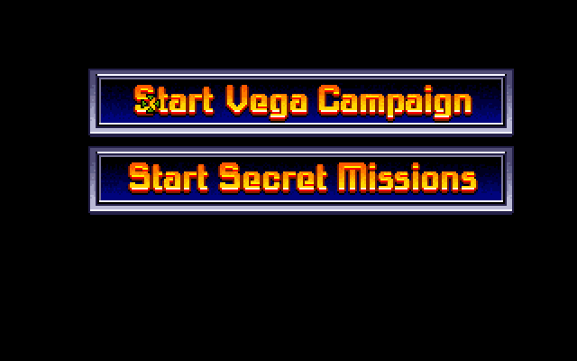
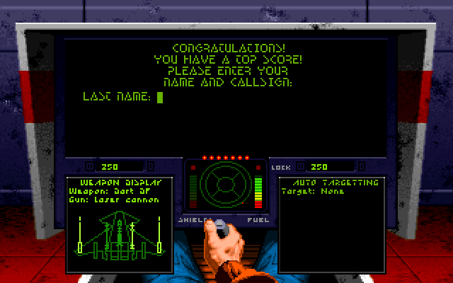

# Wing Commander: Static Recompilation


## What it is

A static recompilation of **Wing Commander** (Origin Systems, 1990), the DOS
version on the *Wing Commander & Wing Commander II* CD, from its shipping
executable to C, built as a native Windows program. No DOSBox, no emulator.
Wing Commander II, from the same disc, lifts and builds too and is next.

`WC.EXE` is a real-mode Borland C++ program with 40 Borland VROOMM overlays,
EMS, VGA mode 13h and Origin's own compressed `.DRV` drivers, which it unpacks
into its heap and calls at run time. [pcrecomp](https://github.com/sp00nznet/pcrecomp)'s
16-bit decoder and lifter turn its 2,100-odd functions to C (the overlays
made resident first, the drivers captured on the first run and lifted on the
next); `src/` is a small model of a 1990 PC (DOS, VGA, EMS, the timer, the
keyboard, an OPL2) for it to run on.

Built on the [pcrecomp](https://github.com/sp00nznet/pcrecomp) toolchain and
following its shared house style (layout, CLI, conformance harness, headless
mode), like the other recomps there. The runtime and lifter came from the
[Mario Is Missing DOS recomp](https://github.com/sp00nznet/marioismissing-dos),
and before it [Corridor 7](https://github.com/sp00nznet/corridor7) and
[Blake Stone](https://github.com/sp00nznet/blakestone).

**Generated source is not distributed.** You supply your own copy of the game,
and the lifted C is generated on your machine into `work/` (gitignored).
Nothing from the game is in this repository.

## Status: **v0.1.0, early alpha. In game: the first mission (Hornet, Enyo, Nav 1) flies, with keyboard control, from the sign-in through the bar, the barracks and the briefing.**

| Area | State |
|---|---|
| Version recompiled | `WC1\WC.EXE` from *Wing Commander & Wing Commander II* (USA) CD, 304,976 bytes |
| Lift (`tools/lift.py wc1`) | 2,163 functions (40 overlays resident, 2 run-time drivers), 116,093 instructions, 0 unresolved; pcrecomp's own decoder, no IDA |
| Borland VROOMM overlays | ✅ 40 made resident (pcrecomp `tools/drm/vroomm.py`) |
| EMS | ✅ detected and filled ("Expanded Memory fully used") |
| The `.DRV` drivers it unpacks at run time | ✅ `TM.DRV` and `SUPERTM.DRV` captured at 36B4h and 3B93h on the first run and lifted on the next (pcrecomp `codeblob16`); 52 driver entries, no misses on the paths below |
| Title, intro, main menu | ✅ the concert-hall intro, the Earth flyby and the credits; the *Claw Marks* copy question (answer it); "Start Vega Campaign" |
| Pilot sign-in (the simulator screen) | ✅ name and callsign typed in; the simulator high scores |
| Bar, barracks, briefing, launch | ✅ hover labels and clicks; Halcyon's briefing plays through; the launch cut-scene |
| The first mission | ✅ flies: throttle, stop and turning answer the keys, asteroids and the planet move past. Not yet flown to the end; untouched it hits an asteroid and the funeral plays |
| Sound and music | ❌ not yet (no sound card configured) |
| Wing Commander II (`wingcommander2`) | lifts (124 overlays, 2,076 functions); not built or run yet |
| Headless mode | `--headless` with `--seconds`, `--keys`, `--shot-at`; `--record out.mp4` pipes to ffmpeg |
| Self-test (`selftest.exe`, no game data) | ✅ passes: the VGA, x87 and Sound Blaster/AdLib models |
| Conformance harness against the game | not yet ([ROADMAP](ROADMAP.md)) |
| `Setup.cmd` | written, not yet run from a clean clone; a fresh lift also needs one capture round ([ROADMAP](ROADMAP.md)) |
| Installer (recomp-launcher) | `launcher/launcher.json` and a manual-run workflow; no installer has been built yet |
| Toolkit | pcrecomp's `pcrecomp-dos16-wc` branch (off `pcrecomp-ne-nativemap`), not merged into `main` yet |

## Screenshots

Real output of the recompiled game:

| | |
|---|---|
|  |  |
| The intro | The Earth flyby |
|  |  |
| A Kilrathi fighter in the intro | The credits |
|  |  |
| The main menu | The new pilot sign-in, in the simulator |
|  | |
| The first mission, in the Hornet's cockpit | |

## Getting Started

You need **your own Wing Commander & Wing Commander II CD** (or a mounted
image of it, or a copy of its `WC1` folder) and about 1 GB free. Nothing is
downloaded for you.

### Quick start: Setup.cmd

1. Download this repository (the green **Code** button, then **Download ZIP**)
   and unzip it.
2. Put the disc in (or mount its image).
3. Double-click **`Setup.cmd`**.

It checks for Python 3, CMake, Git and the Visual Studio 2022 C++ build tools,
and **asks** before installing any of them with winget, saying what and how
big. It finds `WC1\WC.EXE` on any drive, or asks where it is
(`Setup.cmd -GameDir E:\` skips the question, `-Yes` answers yes to every
install). Then it copies the `WC1` folder into `original\wc1`, clones
pcrecomp's `pcrecomp-dos16-wc` branch beside this folder (as
`pcrecomp-dos16-wc`), lifts `WC.EXE`, builds, runs the self-test, and leaves
a **`Wing Commander`** shortcut in this folder. A rerun skips finished steps
(`-Force` redoes the lift). If it stops, it says why in one sentence, and the
details are in `setup.log`.

### Step by step

Prerequisites: Windows 10/11, Python 3.10+ (`py --version`), CMake 3.20+,
Git, and Visual Studio 2022 (or its Build Tools) with *Desktop development
with C++*. ffmpeg on `PATH` only for `--record`.

1. **The toolkit**, beside this folder, on its `pcrecomp-dos16-wc` branch:
   ```
   git clone --branch pcrecomp-dos16-wc https://github.com/sp00nznet/pcrecomp ..\pcrecomp-dos16-wc
   set PCRECOMP_HOME=%CD%\..\pcrecomp-dos16-wc
   ```
   Without `PCRECOMP_HOME`, `tools\lift.py` and CMake look for
   `..\pcrecomp-dos16-wc`, then `..\pcrecomp`.
2. **Your game files**: copy the CD's `WC1` folder, all of it, into
   `original\wc1\` (so that `original\wc1\WC.EXE` exists). For Wing
   Commander II, `WING2\GAMEDAT\*` and `WING2\WC2.EXE` into `original\wc2\`.
3. **Lift**:
   ```
   > py tools\lift.py wc1
     overlays: 40 placed resident, 162253 bytes, 867 entries
   WC.EXE: DGROUP 1231, ... functions, ... instructions lifted, ...
     -> ...\work\wc1\gen
   ```
4. **Build** (a few minutes):
   ```
   cmake -B build -A Win32 -DPCRECOMP_HOME=%PCRECOMP_HOME%
   cmake --build build --config Release --target wingcommander selftest -- -m
   build\Release\selftest.exe
   ```
5. **Capture the drivers, once.** A fresh lift has never seen the `.DRV`
   code. Run it headless, which captures the drivers into
   `work\wc1\blobs\` (the entry points it needs are already in
   `tools\wc1_seeds.txt`), then lift and build again:
   ```
   build\Release\wingcommander.exe --headless --seconds 20
   py tools\lift.py wc1
   cmake --build build --config Release --target wingcommander -- -m
   ```
   The lift then prints `blobs: 36B4 (...) at 10000, 3B93 (...) at 11000`.
6. **Play**, from this folder (it reads `original\wc1` and keeps saves in
   `saves\wc1`): `build\Release\wingcommander.exe`. Esc skips the intro.
   The copy check asks a question from the *Claw Marks* manual. "Start Vega
   Campaign" is clicked with the mouse.

The usual trip-ups: `python` opening the Microsoft Store (that is Windows'
alias placeholder; use `py`); a freshly installed tool not being on `PATH`
until you open a new window; and a `..\pcrecomp` on `main`, which lacks
`codeblob16.py` and `vroomm.py`.

## Usage

```
build\Release\wingcommander.exe                                   # play, in a window
build\Release\wingcommander.exe --headless --seconds 40 --shot-at "20000:C:\tmp\wc.bmp"
build\Release\wingcommander.exe --headless --keys "8000:ENTER,9000:SPACE" --record run.mp4
build\Release\selftest.exe                                         # the hardware models, no game data
```

| Flag | |
|---|---|
| `--data DIR`, `--save DIR` | the game's files (default `original\wc1`), saves (default `saves\wc1`) |
| `--headless` | no window, no audio device; time is deterministic |
| `--realtime` | headless, but on the wall clock |
| `--record OUT.mp4` | video and audio through ffmpeg |
| `--seconds N` | quit after N seconds of emulated time |
| `--keys LIST` | scripted input, `ms:KEY[+holdms],...`; `CLICK@x;y` clicks and `MOVE@x;y` hovers at mouse coordinates (0-639, 0-199) |
| `--shot FILE.bmp`, `--shot-at "ms:file.bmp,..."` | the last frame at exit, or frames at emulated times |
| `--wav OUT.wav` | write the audio |
| `--mute`, `--scale N`, `--fullscreen`, `--display sharp\|pixel\|crt` | sound off, window size, fullscreen (Alt+Enter toggles), display mode |
| `--trace` | log DOS and EMS calls to stderr |

The full list is at the top of [`src/main.c`](src/main.c).

## Building from source

Steps 1 to 5 above; `Setup.cmd` runs the same commands. How the pieces fit is
[docs/architecture.md](docs/architecture.md) (the pipeline and the machine
model, from Blake Stone); what this game needed (the disc, VROOMM, EMS, and
the drivers it unpacks at run time) is [docs/lifting.md](docs/lifting.md).
The self-test builds without any game data, so it builds and runs on its own.

## Credits

The runtime and lifter came from the
[Mario Is Missing DOS recomp](https://github.com/sp00nznet/marioismissing-dos),
and before it [Corridor 7](https://github.com/sp00nznet/corridor7) and
[Blake Stone](https://github.com/sp00nznet/blakestone).
[ymfm](https://github.com/aaronsgiles/ymfm) (BSD-3-Clause). See [NOTICE](NOTICE).

## License

MIT for the code in this repository; see [LICENSE](LICENSE), and
[NOTICE](NOTICE) for the third-party code. Wing Commander is commercial
software (Origin Systems, now Electronic Arts) and is not included.
